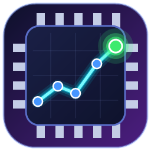

# Dopplers GPU Tune



A small Windows program that finds the **best VRAM clock for AI work** on an NVIDIA card.

AI inference is mostly *memory bound*: more VRAM clock means more tokens per second. But the card has one power
limit, so a higher memory clock can lower the GPU core boost clock. This program measures that trade-off on your card:

* a **slider** sets the memory clock offset, **-500 ... +750 MHz**;
* **TEST** runs an LLM benchmark (token generation, inside this program, with the llama.cpp runtime) while sampling the
  **real** memory clock, core clock and power of the card;
* every test adds a **dot to the graph**: x = VRAM clock the card really ran at, y = tokens per second. The list beside
  the graph shows the core clock and power of every dot; the best dot is green.

Move the slider, press TEST, repeat; the highest dot is the best combination for your card (and the core clock column
shows what you pay for it).

## Using it

1. Put the **llama.cpp runtime** in `runtime\` (see `runtime\README.txt`; about 700 MB with the CUDA libraries).
2. Run `GpuTune.exe` (it asks for Administrator: only an administrator can change the clock).
3. Pick a test model and press **Download model** (resumable; the 4B model is 2.5 GB, the 1.7B model 1.1 GB), or
   **Browse...** for any `.gguf` file. Models go to `models\`.
4. Move the slider and press **TEST**. The first TEST of a model also loads it (a few seconds), the next ones take
   about 5 seconds.

Notes

* **MSI Afterburner (or any other overclocking tool):** set its memory offset to **0** first. The driver reports 0 for
  Afterburner's value, and the two offsets can add up. The program warns you when Afterburner is running.
* The graph uses the **measured** clock, so it stays right even if the driver's units differ from your tool's. The
  box "Driver units per slider step" scales the slider value before it is sent to the driver (1 = same MHz).
* The offset the card had when the program started is restored when the program closes (and with the button
  **Restore the original offset**).
* Test results are kept in `gputune.csv` next to the program (one row per dot, with the model name).
* A memory overclock that is too high can produce silent errors. If the same test gives different speeds, or you see
  artifacts, go back down.

## Building

Needs the w64devkit toolchain (`c:\workenv\w64devkit`):

```
build.bat        GpuTune.exe       asks for Administrator, changes the clock
build.bat dry    + GpuTune-dry.exe never writes an offset, no elevation: for testing the window and the measurement
```

The program has no dependencies besides the NVIDIA driver (`nvml.dll`) and the files in `runtime\`. It loads
`runtime\llama.dll` by hand, so only the llama.cpp headers (`include\`, MIT licence) are needed to build.

## Files

| | |
|---|---|
| `src\gputune.cpp` | the whole program (NVML, llama.cpp benchmark, downloader, window, graph) |
| `res\` | icon (`gputune.ico`), manifests, resource scripts |
| `include\` | llama.cpp / ggml headers (build 12282) |
| `runtime\` | llama.cpp runtime DLLs (not in git) |
| `models\` | downloaded test models (not in git) |

## Licence

The program is free to use. llama.cpp / ggml are MIT licensed (`LICENSE-llama.cpp.txt`). The NVIDIA CUDA libraries in
`runtime\` are NVIDIA's and redistributable under their licence.
